# Speed Budget

**A fast, simple budgeting app for Windows.** You decide what each month's money is for, type in your transactions as
they happen, and see at a glance what is left on every budget item. Everything stays on your own PC.

> Speed Budget is a pre-release (version 0.9). It works and is in daily use, but expect rough edges, and keep
> backups of anything you care about (the app makes one for you every day).

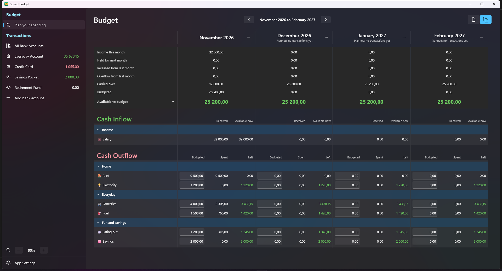

## Contents

- [What it does](#what-it-does)
- [A look at the app](#a-look-at-the-app)
- [Install](#install)
- [First time you open it](#first-time-you-open-it)
- [How it works](#how-it-works)
- [Everyday use](#everyday-use)
- [Keyboard shortcuts](#keyboard-shortcuts)
- [Your data, backups and settings](#your-data-backups-and-settings)
- [What is not there yet](#what-is-not-there-yet)
- [Questions and problems](#questions-and-problems) · [Licence](#licence) · [For developers](#for-developers)

## What it does

- **Plan every month.** Give each budget item an amount, see what was spent and what is left, and look up to a year
  ahead. Several months sit side by side.
- **Months you draw yourself.** A month starts where you put its line in the transaction list (say, on payday), not on
  the 1st.
- **Left over carries over.** Money left on an item moves to the next month on the same item. Overspend an item and the
  shortfall comes out of the next month's money still to be assigned.
- **Fast transaction entry.** Add a row, pick the counterparty and the app fills in the budget item and account you last
  used with it. Edit any row in place. Type sums such as `1200+350` into any amount.
- **Split transactions** over several budget items, and **transfers** between accounts.
- **Budget accounts and tracking accounts.** A cheque or savings account takes part in the budget. A retirement fund or
  home loan can be tracked on the side without touching the budget.
- **Move and cover money.** Allocate what is available to an item, move what is left from one item to another, or cover an
  overspent item from items that have money left.
- **Hold income for next month,** so you budget with money you already have.
- **Expected transactions.** Note down what you expect but has not happened yet, without changing any balance.
- **Filter like in Excel,** see everything in **All Bank Accounts**, and press any Received or Spent figure on the Budget
  screen to see the transactions behind it.
- **Undo and redo** (`Ctrl+Z`, `Ctrl+Y`) on any screen.
- **Zoom** from 50% to 200%, remembered separately for the Budget and the transaction screens. Everything shrinks to fit a
  narrow window, so it sits comfortably beside your banking website.
- **Safe by default.** One file on your PC, an automatic backup every day, restore from any backup, CSV and JSON export,
  and no account or internet connection needed.
- **Updates itself.** A bar tells you when a new version is out and shows what changed before you update.

## A look at the app

*The pictures use made-up example data.*

### Getting started

**First time you open it.** A short setup wizard helps you create your bank accounts, budget groups and items, and the
counterparties you deal with most. You can start from a typical household list, a short minimal list, or empty. Nothing is
saved until the last step.

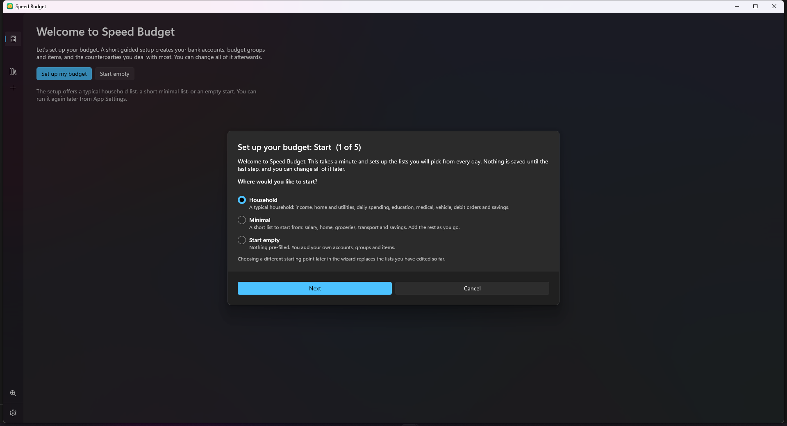

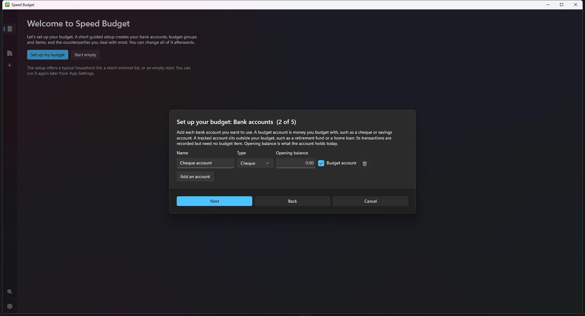

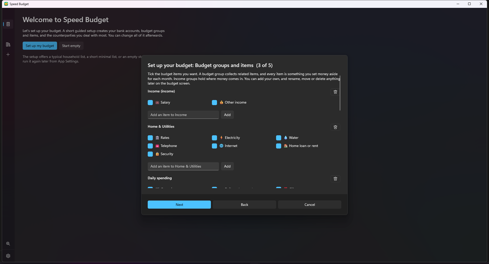

### Plan your spending

Give every budget item an amount for the month, and see what was spent and what is left (green when there is money left,
red when overspent). The figures at the top show what you still have available to budget, and the Cash Inflow and Cash
Outflow sections list your income and your spending groups.

**Hold, allocate, move and cover.** Right-click **Available to budget** to allocate some of it to an item, or to hold part
of it for next month. Right-click a **Left** figure to move money from that item to another one (or to cover an overspent
item from items that have money left). Each box leads with the figure it is about, in green for money there is and red for a
shortfall.

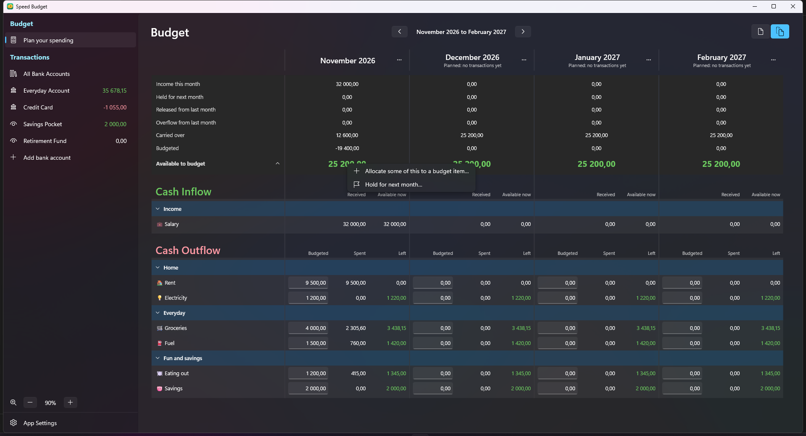

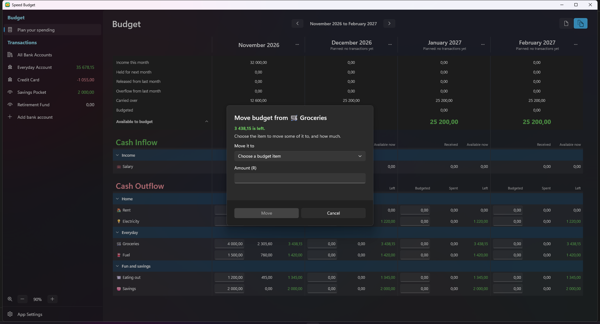

### Transactions

Each bank account has its own page with its balances (cleared, uncleared and available), month lines that show where each
budget month starts, and a table you edit in place. The strip at the top can pin up to five budget items so you can see
what is left on them while you work.

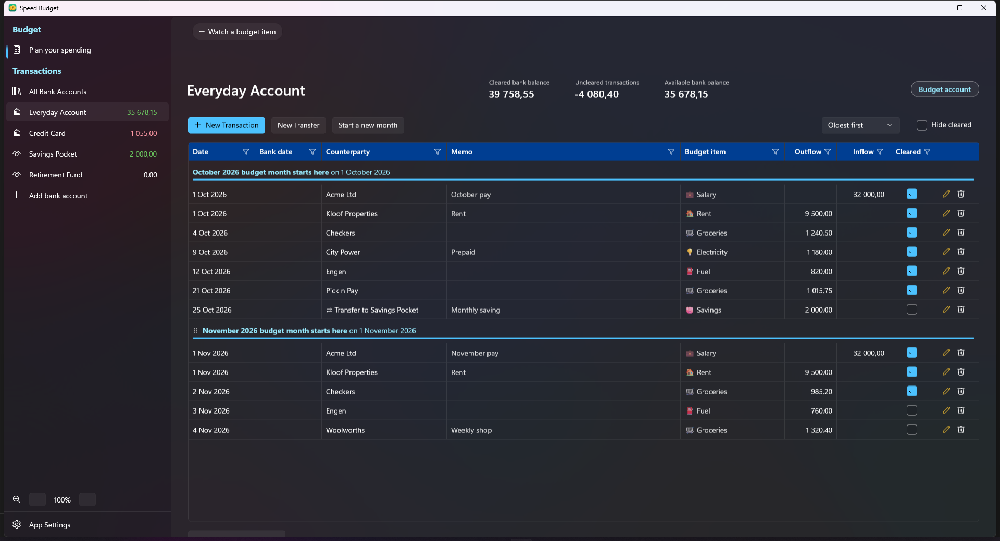

**All Bank Accounts** shows every account together, with an Account column to tell them apart, and transfers appear on both
sides.

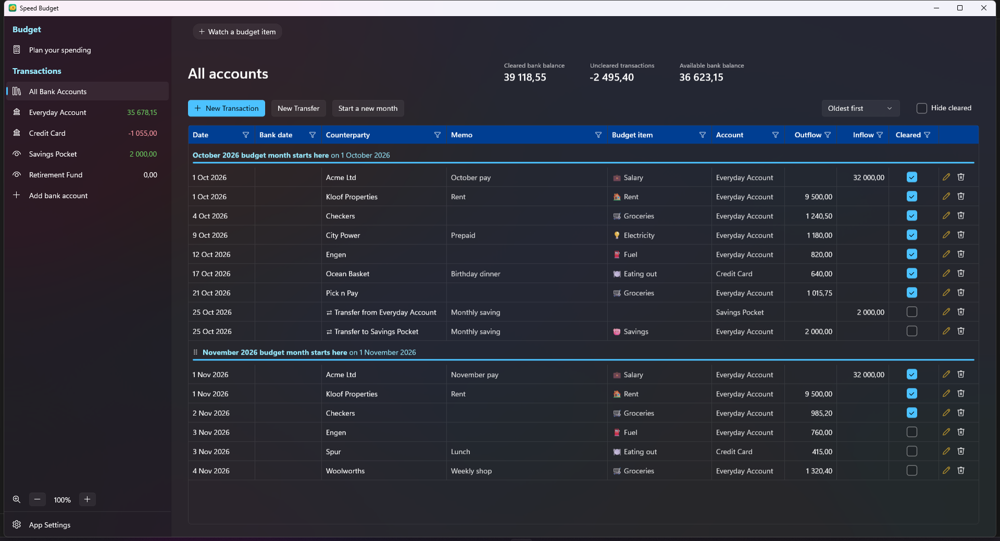

**Edit in place.** Press a row's pencil and its cells become boxes. Pick a budget item from the drop-down, which shows what
is left on each item, or type to search.

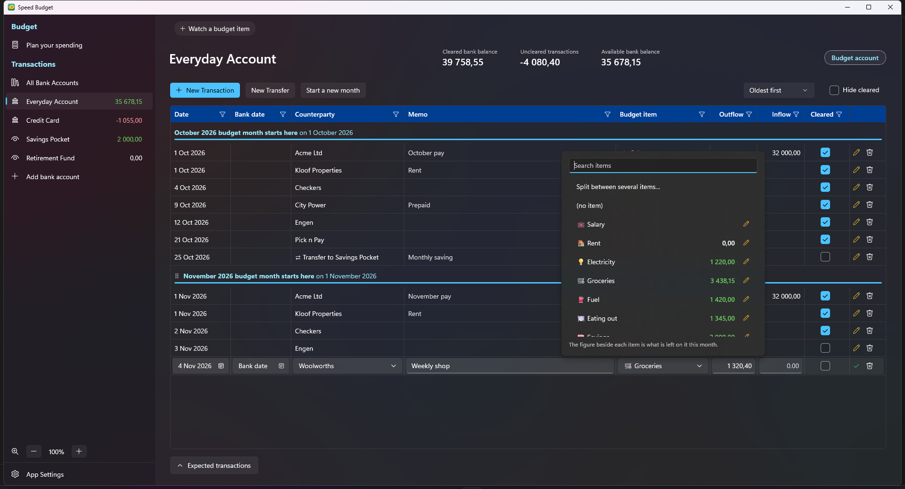

**Counterparties are managed where you use them.** Each has a pencil (rename it, change its icon) and a bin in the
drop-down, and typing a new name adds it on the spot.

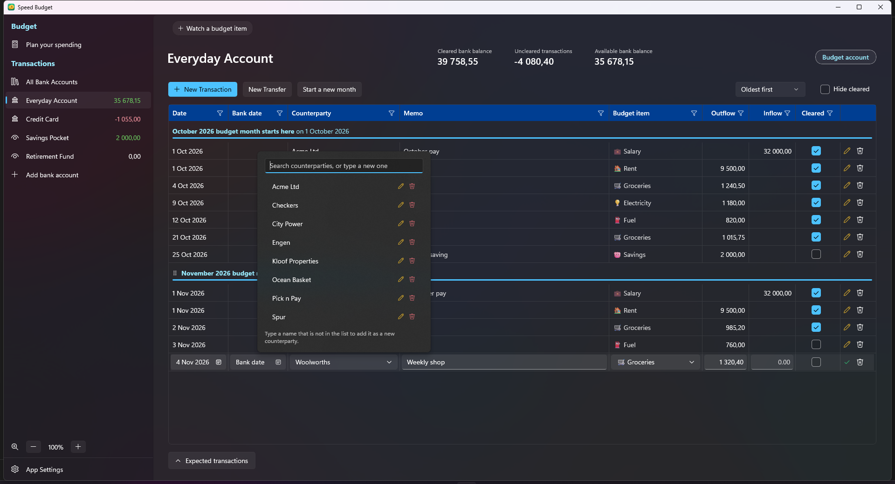

**Split a transaction** between several budget items, for example a supermarket trip that was part groceries and part
household goods. The lines must add up to the total.

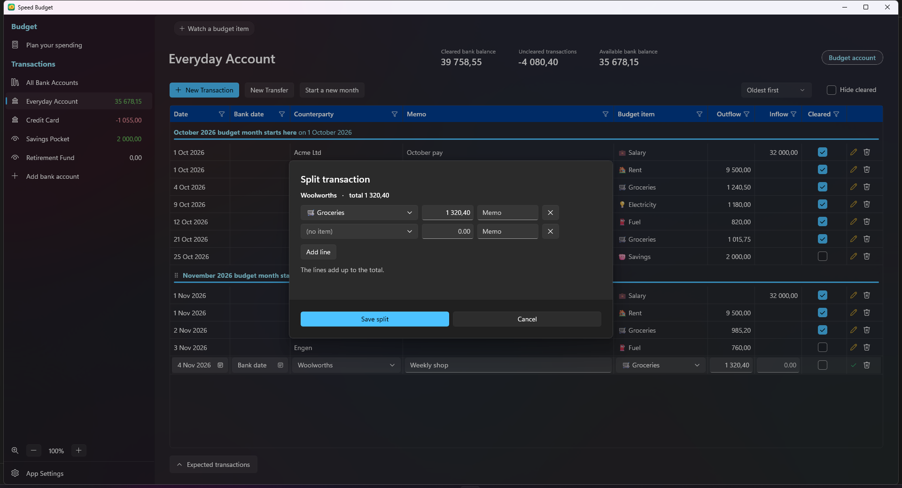

**Filter every column.** Press the small funnel on a column heading, tick the values you want (or search), and press OK.

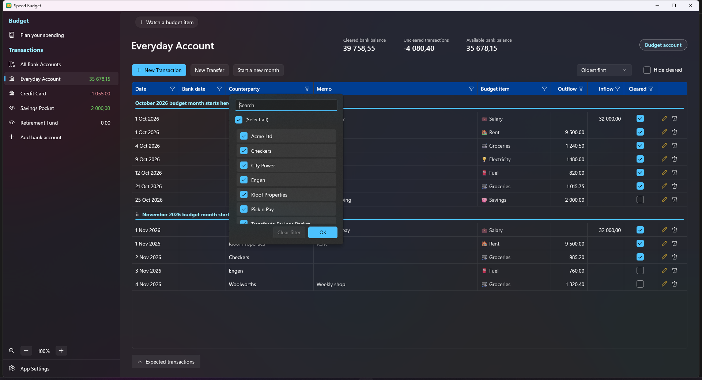

**Month lines.** Select a month line to change the date it starts, move it up or down, or delete it. The panel slides in over
the table.

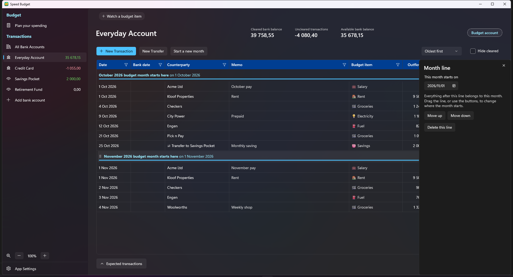

**Expected transactions.** The bar along the bottom of every account opens a list of what you expect but has not happened
yet. Nothing in it changes a balance or the budget. When one happens, move it into the table and give it a date.

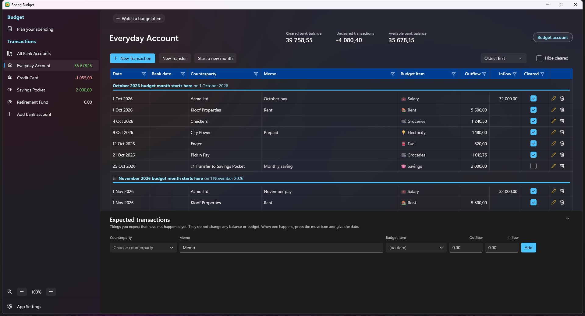

**Tracking accounts.** Accounts such as a retirement fund can be tracked without affecting the budget. They are labelled
*Tracking account* and have no budget item column.

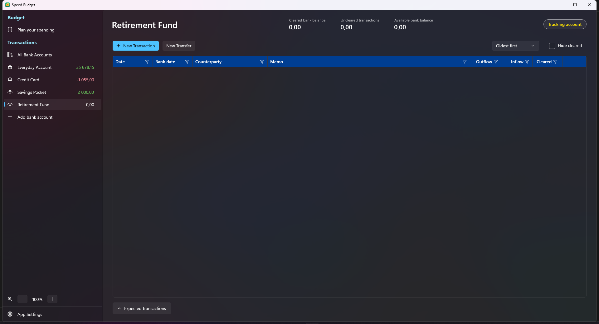

**Add a bank account** from the left panel: give it a name, a type, whether it counts toward the budget, and its opening
balance. Right-click an account for **Edit account**, **Close account** or **Delete account**.

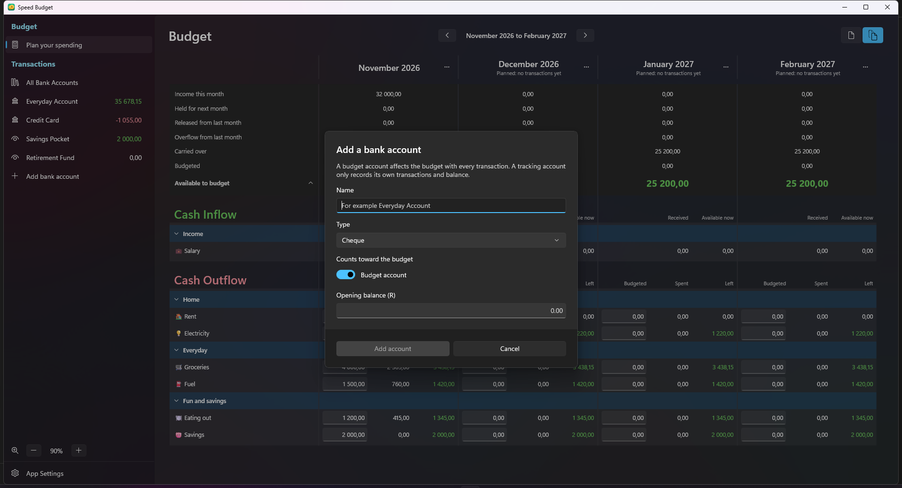

### App Settings

Choose how the side panel behaves, back up and restore your data, export it, check for updates and more. A **Show keyboard
shortcuts** button opens the full list.

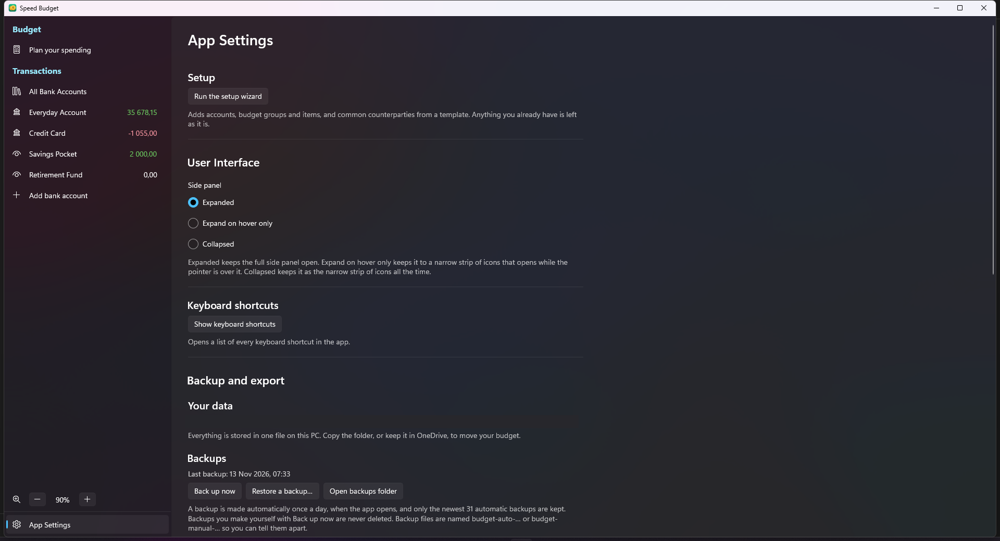

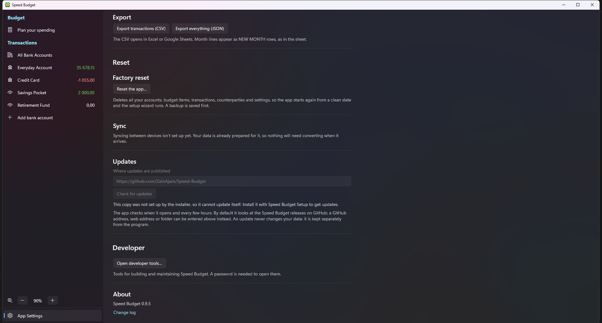

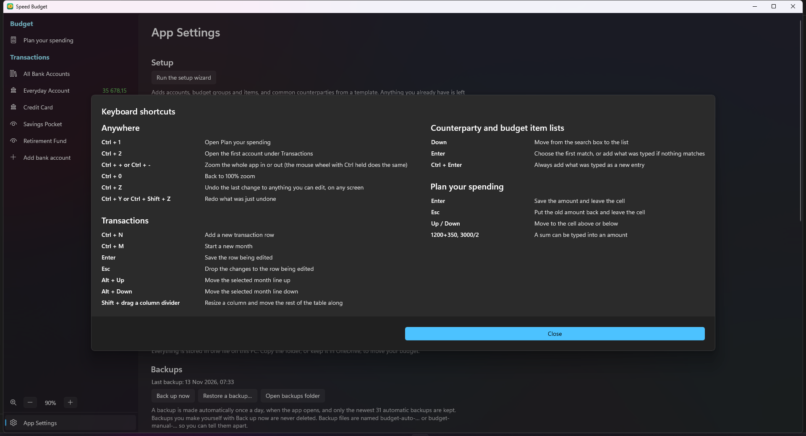

## Install

1. Open the [Releases page](https://github.com/ZainAjam/Speed-Budget/releases) and download
   **`SpeedBudget-App-win-Setup.exe`** from the newest release.
2. Run it. It installs for your own account only, so it needs no administrator rights and nothing else to be installed.
   Speed Budget then opens, and you get a Start menu and desktop shortcut.
3. **Windows may warn you the first time** ("Windows protected your PC") because the installer is not signed with a paid
   certificate. Choose **More info**, then **Run anyway**.

You need 64-bit Windows 10 (version 1809 or later) or Windows 11.

**Updates are automatic.** When a newer version is released, a bar appears at the top of the app. Press
**What's changed** to read what is new first, then **Update and restart**. The app takes a backup of your data first, and an
update never changes your budget. The full list of changes is in [CHANGELOG.md](CHANGELOG.md) and in the app under
**App Settings > About > Change log**.

**To uninstall,** use Settings > Apps > Installed apps in Windows. This removes the program but keeps your data.

## First time you open it

A short setup wizard starts by itself (five steps). It helps you create:

- your **bank accounts**, and whether each is a *budget account* (money you budget with, like a cheque or savings
  account) or a *tracked account* (outside your budget, like a retirement fund or a home loan);
- your **budget groups and items**, from a ready-made template (Household, Minimal, or empty) that you can tick and edit;
- the **counterparties** you deal with most, such as shops and your employer.

Nothing is saved until the last step, you can change everything later, and you can run the wizard again from
**App Settings** (it only adds what is missing).

Your budget has a **start date**. It begins as the first day of the current month, and the first "(month) budget month
starts here" line at the top of the transactions table is where it sits. Nothing in the budget can be dated before it. If
you add or edit a transaction dated earlier, Speed Budget asks whether to start the budget from that month instead, and adds
the months in between. You can also select that first line and choose a different start date: an earlier one adds the months
in between (what you have already budgeted stays where it is), a later one is allowed while no transaction or month line
comes before it. The date and the month are separate: a budget that starts on 24 October can be the start of November.
Select the first line and choose both the date it starts on and the budget month that the transactions after it belong to.

## How it works

- **Budget items** are the things you set money aside for each month, such as Groceries, Petrol or Electricity. They
  sit in **groups** (Home, Vehicle, ...). Income items, such as Salary, hold the money coming in.
- **Transactions** are what actually happens: money out or money in, on a date, with a **counterparty** (who it was
  with: the shop, the person, your employer) and the budget item it counts against.
- **Months are drawn by you, not by the calendar.** In the transaction list there is a line that says
  "*February 2027 budget month starts here* on 24 January 2027". Everything after the line belongs to that month. If your
  pay arrives on the 25th, put the line there. You can drag the line to move it. If you forget a line, no month is lost: the
  Budget screen still shows every month between your lines, and you can budget for it.
- On the **Budget** screen you give each item an amount for the month. The screen shows what you budgeted, what you
  spent and what is **left**. Money left on an item carries over to the next month on that same item. If you overspend an
  item, the shortfall comes out of the next month's money still to be assigned.
- **Budget accounts and tracking accounts.** Every transaction in a budget account counts against a budget item. A tracking
  account only records its own transactions and balance. A transfer between a budget account and a tracking account counts
  as spending or income against a budget item you choose, and a transfer between two budget accounts (or two tracking
  accounts) needs no budget item.

## Everyday use

**Record a transaction.** On a Transactions screen press **New Transaction** (or `Ctrl+N`). A new row appears as the latest
record, dated today, ready to fill in. Pick the counterparty (the app fills in the budget item and account you last used
with it), choose the budget item, and type an **outflow** (money out) or **inflow** (money in). Press `Enter` to save the
row, or `Esc` to throw it away. Typing a new counterparty or budget item adds it on the spot. Tick **Cleared** once the
transaction has shown on your bank statement. If the row is dated on the day a month starts, you are asked which month it
belongs to. In every money box you can type either a point or a comma as the decimal mark, and sums such as `3.5+1.5` or
`1 250 + 350` work too.

**Move money between accounts.** Press **New Transfer** for a new row in the same way: the Account box is the account the
money leaves (or arrives in, if you type an inflow) and the Counterparty box is the other account. Both sides share the
date, memo and amount, and change together when you edit either.

**Edit a transaction in place.** Press the pencil at the end of a row and its cells turn into boxes (clicking a value only
highlights the row): change the date, counterparty, memo, budget item, account, outflow, inflow or bank date right there.
Press `Enter` to save, or `Esc` to put the row back as it was. The pencil becomes a green tick while editing, and the bin
deletes the transaction. You can also right-click a row for **Edit** and **Delete** (**Save** and **Delete** while it is
being edited).

**Split a transaction.** Open a transaction's budget item drop-down and choose **Split between several items**, then give
each item its share; the shares must add up to the transaction's amount. A split transaction shows "Split (2 lines)", and
pressing that shows its lines. You can also split while adding a new transaction. To turn a split back into an ordinary
transaction, open its drop-down and choose a single item.

**Bank date.** The table shows each transaction's date and, beside it, the date it showed on your bank statement. Entering a
bank date on a transaction also marks it as cleared. Use **Hide cleared** and the **Oldest first / Newest first** box above
the table to focus on what is still open.

**Filter and see what makes up a figure.** Every column heading has a funnel for filtering, like in Excel (a filtered column's
funnel turns gold, and a **Clear filters** button appears). On the Budget screen, press a figure in the **Received** or **Spent** column and All Bank Accounts
opens showing only the transactions that make up that figure.

**Plan your budget.** Open **Plan your spending** (under the Budget heading in the left panel). Click an amount to edit it:
`Enter` saves and leaves the cell, `Esc` cancels, the arrow keys move between cells, and you can type sums such as
`1200+350`. Months ahead are shown as planned, so you can fill them in early (the budget looks 12 months ahead). Use the two
buttons at the top right to see one month or several. Press the months at the top to pick a month and year and jump straight
to it, and a small calendar button takes you back to the month you are recording transactions for.

**Start a new month.** When your month rolls over, press **Start a new month** (or `Ctrl+M`), give the month a name and a
start date, and a line appears in the list. Drag it up or down to fine-tune, select it and use `Alt+Up` / `Alt+Down`, or
select it and change the date it starts on. If you add a transaction or transfer on the very day a month starts, the app
asks which month it belongs to, because that day could be either.

**Move money around the budget.** Right-click **Available to budget**: when it is green you can **allocate** some of it to
any item or **hold it for next month**; when it is red you can **cover** the shortfall from items that have money left.
Right-click a **Left** figure: when green, move some of it to another item; when red, cover it from another item. A small
flag beside Available to budget shows that money is held.

**Hold income for next month.** Hold part of this month's pay so that it becomes available the following month instead. The
month shows how much was held and how much was released into it.

**Watch the items that matter.** The strip at the top of the Transactions screens can show up to five budget items
with what is left on each. Press **+** to add one, click one to jump to it on the Budget screen, and right-click one to
remove it.

**Balances at a glance.** Under Transactions in the left panel, each account shows its available balance: green when it is
above zero, red when below, and plain when zero. Each account page shows its cleared balance, its uncleared transactions and
its available balance.

**Manage things where you use them.** There are no separate setup pages to hunt through:
- Right-click a **budget item** or **budget group** on the Budget screen to rename it, change its icon, add an item to it or
  delete it. Drag items and groups to reorder them. An item that has ever been used can't be deleted, and you are told why.
- **Counterparties** are renamed and deleted in the counterparty drop-down (one that transactions use can't be deleted).
- **Add bank account** at the bottom of the account list adds an account. Right-click an account to edit it, close it (it stays
  in the list, dimmed, with its history) or delete it if it has no transactions. Drag accounts to reorder them.

**Zoom.** `Ctrl` and `+` or `-` (or `Ctrl` and the mouse wheel) zoom the screen you are on from 50% to 200%, and `Ctrl+0`
goes back to 100%. The Budget and the bank account transactions each remember their own zoom. Everything else stays at
normal size, and the pinned strip, headings and buttons shrink to fit a narrow window.

**Undo and redo.** `Ctrl+Z` undoes your last change to anything you can edit, on any screen (an amount, a transaction, a
budget move, a counterparty, an item, an account), and `Ctrl+Y` redoes it.

**Side panel.** In App Settings, under **User Interface**, choose **Expanded** (the full left panel), **Expand on hover
only** (the default: a strip of icons that opens while the pointer is over it) or **Collapsed** (always the strip of icons).

**Resize the table.** Drag the divider on the right of a column heading in the recorded transactions table: as in Word, the
divider moves between that column and the one next to it, so the table keeps its width and its place. Hold **Shift** while
dragging to change just that column and move everything to its right along with it (the table scrolls sideways if it gets
wider than the window). Your sizes are remembered. Selecting a month line opens a panel over the table from the right edge,
for changing its date; drag its left edge to resize it, and close it with the X or `Esc`.

## Keyboard shortcuts

The full list is under **App Settings > Show keyboard shortcuts**.

| Keys | What it does |
|---|---|
| `Ctrl+1` / `Ctrl+2` | Open Plan your spending / the first account |
| `Ctrl+N` | New transaction |
| `Ctrl+M` | Start a new month |
| `Enter` / `Esc` | Save / drop the changes to the row (or amount) being edited |
| `Alt+Up` / `Alt+Down` | Move the selected month line |
| `Ctrl+Z` / `Ctrl+Y` (or `Ctrl+Shift+Z`) | Undo / redo |
| `Ctrl+` `+` / `-` / `0` | Zoom in, zoom out, back to 100% |
| `Up` / `Down` in the budget | Move to the cell above or below |
| `Down`, `Enter`, `Ctrl+Enter` in a drop-down | Move to the list, choose the first match, or always add what was typed as new |
| `Shift` + drag a column divider | Resize a column and move the rest of the table along |

## Your data, backups and settings

Everything is kept in a single file on your PC, in `%LocalAppData%\SpeedBudget-Data` (the program itself is in
`SpeedBudget-App` beside it). There is no account and nothing is sent anywhere, apart from the check for new versions.
A short `README.txt` in the data folder explains what is in it. The **App Settings** screen (bottom left) lets you:

- **Back up now.** A backup is also made automatically once a day, when the app opens, and the newest 31 automatic backups
  are kept. Backups you make yourself are never deleted. **Restore a backup...** lists them and puts one back (your current data is saved as a manual
  backup first), and **Open backups folder** shows where they are.
- **Export** your transactions to CSV (opens in Excel or Google Sheets) or everything to JSON.
- **Run the setup wizard** again to add more accounts, items or counterparties.
- **Reset the app** to a clean slate. This deletes everything (a backup is saved first), and the setup wizard runs again.
- **Check for updates**, or point the app at a different update source.
- Open the **Change log** from the About section to read what changed in every version.

To move your budget to another computer, copy the data folder (or keep it in OneDrive).

If something goes wrong, `activity.log` in the data folder holds the last things the app did and `crash.log` records each
failure, so a problem can be looked into.

## What is not there yet

Syncing a budget between several devices, several budgets with their own accounts, and phone and tablet apps are planned
but not built. For now the budget lives on the one PC. The data is already prepared for syncing, so nothing will need
converting when it arrives.

## Questions and problems

Please [open an issue](https://github.com/ZainAjam/Speed-Budget/issues) and say what you did and what you expected.

## Licence

Copyright (c) 2026 Zain Ajam. All rights reserved. You are welcome to download and use the app for your own
budgeting; the source code may not be copied or reused without permission. See [LICENSE](LICENSE).

## For developers

Speed Budget is a WinUI 3 app on .NET 10 with a SQLite database (EF Core). Building from source, running the tests and
publishing releases are covered in [docs/DEVELOPING.md](docs/DEVELOPING.md). The original design notes are in
[docs/PLAN.md](docs/PLAN.md).
